# CAuDri Track Description

Portable format for the description of CAuDri-Challenge race tracks/road networks.

JSON or YAML files can be used to describe the track layout including all feautures and track elements that can be present at our competition.
The purpose of this format is to provide a common way to generate, describe and share standardized race tracks. 
Tools like our [track-renderer](https://github.com/CAuDri/track-renderer) and our simulator (WIP) use this format to visualize and interact with the tracks. 

TODO: Cool rendered track image here

## Features

- Interchangeable JSON and YAML formats based on JSON Schema 2020-12
- Language server support for autocompletion and validation
- Graph-based track representation for arbitrary topologies
- Support for all competition features (i.e. traffic signs, obstacles, intersection variants, crosswalks, etc.)
- Default values and implicit properties allowing short descriptions
- Related expansion and validation scripts

## Overview

### Schema

Three files make up the specification of the track description format:
1. `caudri-track.schema.json`: Defines the general structure and required fieldss of a track description
2. `catalog.yaml`: Defines all available road sections, elements and other features, their variants and default properties
3. `regulations.yaml`: A machine-readable version of the CAuDri-Challenge regulations, mostly defining limits and constraints

All three files complement each other.
The schema file serves as the entry point and needs to be referenced in the track description, while the catalog and regulations files are used to validate the track description against the competition rules and available features.

### Expansion & Validation

In addition to the schema files, a track-expansion and three independent validation scripts are provided:

<!-- For human-readability the portable track description format is designed to be as compact and concise as possible.
This is achieved by using default values, implicit features and additions that can be inferred from the competition rules or were chosen somewhat arbitrarily.

While this is convenient for humans, it is much harder for downstream tools like validators or renderers to interpret the track description, since they would need to implement a lot of the same logic that can not be covered by JSON Schema alone. -->

<!-- The `expand_track.py` script therefore takes a track description and expands it to a fully explicit but equivalent representation.
Implicit features and properties are selected, default values, patches and variants are baked in.

This expanded format is fully compatible with the portable track description and can be validated against the same JSON Schema. 
An example can be seen here: [example-track-expanded.json](example-track-expanded.json) (TODO). -->

<!-- Three additional validation scripts are provided, performing independent checks on the track description: -->

- `validate_schema.py`: Validates against the JSON Schema and checks for missing fields, invalid values and other structural issues.
- `validate_geometry.py`: Validates the track topology and geometry, like overlapping sections, invalid connections or placements.
- `validate_regulations.py`: Validates against the CAuDri-Challenge regulations, i.e. numeric limits, closed loops, missing features and other competition rules. 

An overview of the validation scripts and their usage can be found in [docs/validation.md](docs/validation.md).

## How to create a track description

You can start from an empty JSON or YAML file or copy one of the example tracks in the `examples` folder, like [minimal-track.json](examples/minimal-track.json). 

Four root-level properties are always required in a track description:
- `$schema`: Reference to the JSON Schema file
- `id`: Freely chosen identifier for the track
- `sections`: List of all road sections that make up the track
- `root`: Reference to the root section that defines the origin of the map coordinate system

> [!HINT]
> `$schema` should always point to an immutable schema file.  
> Different versions of the schema may be incompatible and lead to validation errors (i.e. a changed default port distance at intersections might lead to a track geometry that can not be constructed anymore).

Local file paths and URLs to the schema file are supported.
It is recommended to simply point to one of our GitHub releases, i.e. [https://raw.githubusercontent.com/CAuDri/track-description/v0.1.0/caudri-track.schema.json](https://raw.githubusercontent.com/CAuDri/track-description/v0.1.0/caudri-track.schema.json). (TODO: Check link)

From there, you can start adding sections, elements, features and zones to the track description.
For more information, take a look at the [Semantics](#semantics) section below, the [example tracks](examples) or check out the [docs/catalog.md](docs/catalog.md) for a full overview of all available features and properties.

An example track might look something like this:

```yaml
$schema: https://raw.githubusercontent.com/CAuDri/track-description/v0.1.0/caudri-track.schema.json # TODO
id: example-track

root: 
  section: section_1
  port: entry

sections:
  section_1:
    type: straight
    parameters:
      length: 10.0
    elements:
      section_1_crossing:
        type: crosswalk
        parameters:
          distance: 2.0

  section_2:
    type: arc
    parameters:
      radius: 5.0
      angle: 90.0

connections:
  - [section_1.exit, section_2.entry]
```

### LSP Support

JSON Schema is supported by many IDEs and editors with language server support, meaning you can have autocompletion, live validation and hover information when writing a track description.

<p align="center">
  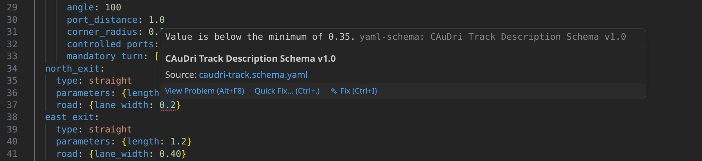
</p>

In VS Code this is a built-in feature for JSON files. 
For YAML files, you need to install the [YAML Language Server (redhat.vscode-yaml)](https://marketplace.visualstudio.com/items?itemName=redhat.vscode-yaml).
No further configuration is required, the language server will automatically pick up the `$schema` property in your track description.

> [!TIP]
> When adding new objects to the track description, you can use `Ctrl+Space` to trigger autocompletion and see all available properties and default values in the current context (VS Code).

## Semantics

### Sections

A track is made up of interconnected road _sections_. 
Each section owns an entry port and one or more exit ports.
Together they define a nominal "direction of travel" from entry to exit.

<p align="center">
  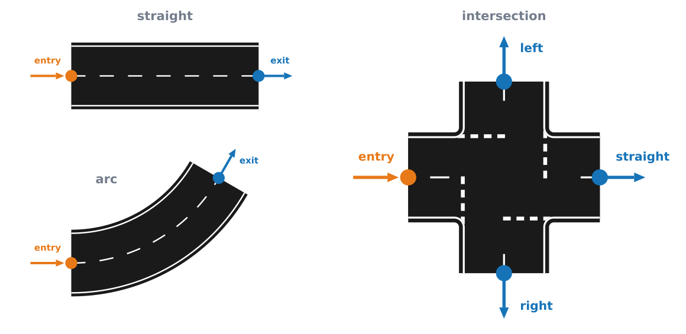
</p>

Sections can be connected to each other via their ports, forming a directed section graph.
This enables complex track layouts including loops, branches and dead ends.

Currently supported sections are `straight`, `arc`, `clothoid` and `intersection`.
They each have type specific parameters and can contain nested elements, features and section-local zones.

The position and orientation of each section is defined relative to its entry port and as a result dependend on the geometry of all of its predecessors in the section graph.
The root section is fixed to the [map coordinate system](#map-coordinate-system), all other sections are positioned relative to it.

<p align="center">
  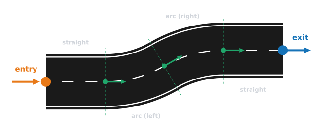
</p>

Entry ports can only be connected to exit ports of other sections, and vice versa.
Only at intersections can multiple exit ports be connected to each other.
Consequently, all branches between intersections have a uniform direction.

The directionality does not affect the drivability of the vehicle but it allows for simple relative positioning of track elements using side and direction keywords like "left", "right", "forward" and "backward".
The desginated route and the path of actors and zone spans can also be inferred from the directionality of the section graph.

<p align="center">
  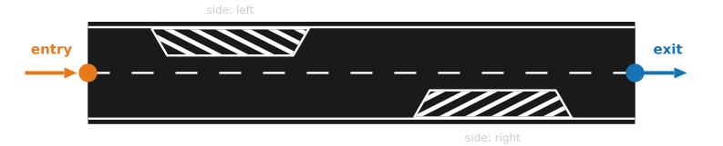
</p>

### Elements

Sections can contain multiple road _elements_ that modify or add to the road surface markings and usually demand specific vehicle behavior around them.
Examples include `starting_line`, `crosswalk`, `barred_area`, `parking_area` and `side_road_junction`.
In a way, these elements somewhat resemble the main elements of the obstacle evasion course.

<p align="center">
  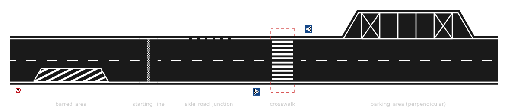
</p>

Elements are positioned in the local coordinate system of their parent section and can be oriented relative to the section's "travel direction" (see [Coordinate Systems](#coordinate-systems)).
Elements with with variable length can be defined using a `range` property with start and end points along the section's reference line.

Not every element is compatible with every type of section.

### Features

_Features_ can represent additional static objects present on the track.
In contrast to elements, they are usually not part of the road surface but rather 3D objects placed on top of the track or surrounding environment.
Examples include `traffic_sign`, `landmark`, `static_obstacle` and 'surface_marking'.

<p align="center">
  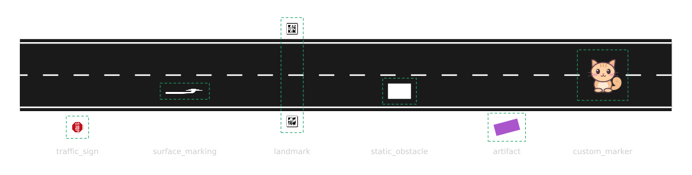
</p>

Features can be defined and positioned globally or locally within a section, as part of an element or the section itself.
Many elements and sections will automatically generate features that don't need to be listed explicitly in the track description.
Examples are corresponding traffic signs and surface markings in front of crosswalks or intersections.

### Zones 

Zones are similar to elements but can be defined globally to span multiple sections.
Examples are `speed_limit` zones, `no_passing` zones, missing `lane_marking` and `centerline` modifiers.

<p align="center">
  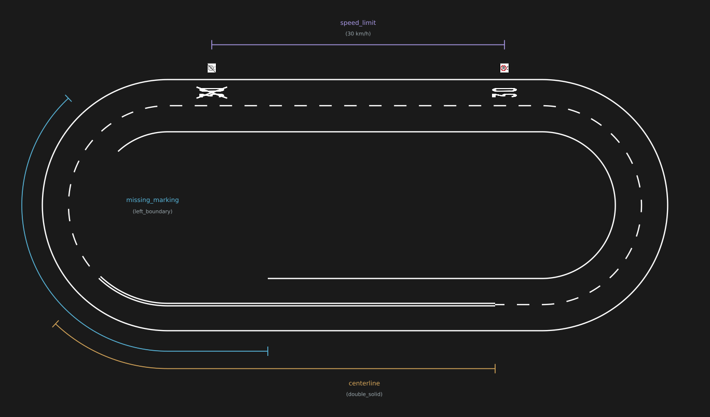
</p>

Zones are defined with a start and end position in section-local coordinates and can be oriented relative to the nominal direction of travel.
In the forward direction, the zone span will begin at the start position and traverse the section graph until it reaches the end. 
Zones can continue across intersections follwing the mandatory turning direction or straight by default.
Essentially, zones adhere to the same rules as the construction of the designated route.

<p align="center">
  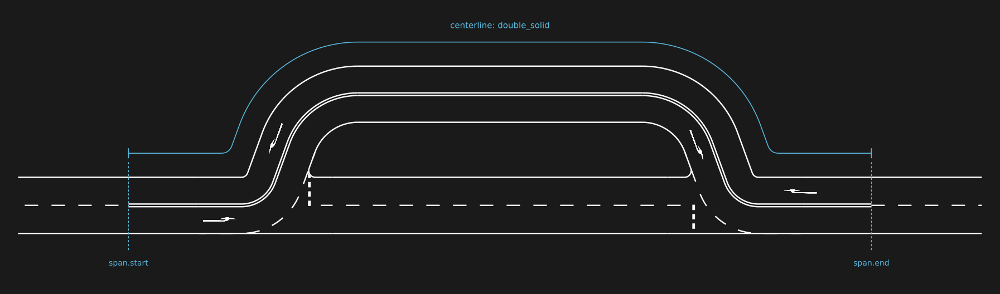
</p>

A valid zone span is not guaranteed to exist for arbitrary start and end positions and will be rejected by the validator if it cannot be constructed.

### Actors (WIP)

Actors are dynamic objects that can be placed on the track and show specific behavior, like following a path.
They are primarily used for simulation purposes.
Two actors are currently supported: `dynamic_obstacle` and `pedestrian`.

Their spawn position can be defined in the track description, the actual dynamic behavior is currently still being worked on.

<p align="center">
  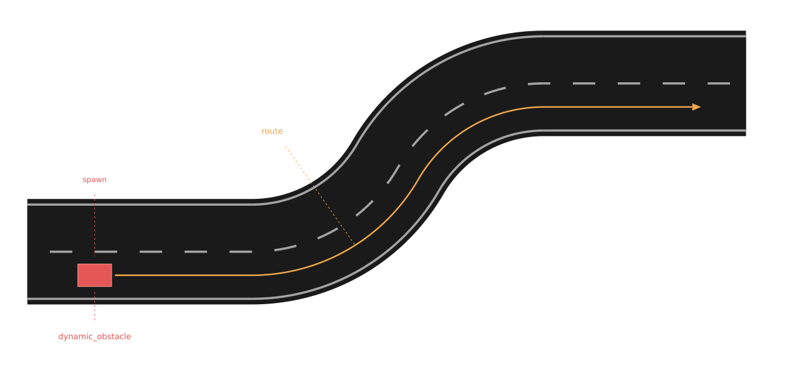
</p>

### Coordinate Systems

#### Map Coordinate System

A track ist positioned in a global `map` coordinate system, with its origin at one of the root section's ports.
For a _left arc_ root section, the _exit_ port will be chosen by default. 
This way, a start box and starting line can be placed, with the vehicle pointing in the positive x-direction of the map coordinate system. 
For all other root section types, the _entry_ port will be used, since that is usually more convenient.

<p align="center">
  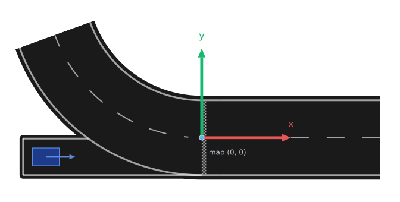
</p>

The port where the map origin is placed can be overridden with `root.port: [entry|exit]`.

The map coordinate system is right-handed, with the x-axis always pointing in the direction of travel at the root port and the y-axis pointing to the left.

#### Section-local Coordinate Systems

Since position and orientation of sections are relativ and derived from the section graph, using global coordinates for nested elements and features would be inconvenient.

For each section, a local coordinate system is defined with its origin at the section's entry port.
The x-axis points in the forward direction and the y-axis to the left, following the map frame's convention.

<p align="center">
  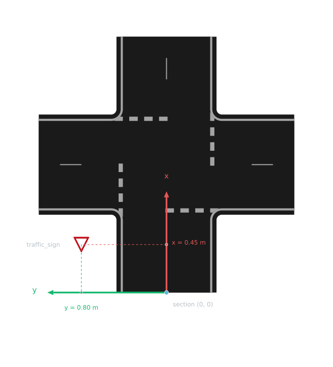
</p>

For all two-port sections (straight, arc, clothoid), an even simpler way to define positions can be used:
A `distance` property defines a position along the section's reference line (centerline) and a `offset` the perpendicular offset from the reference line.

<p align="center">
  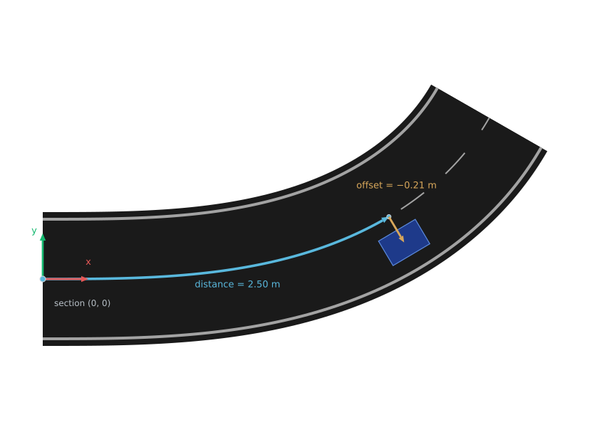
</p>

The "distance" is always measured from the section's entry port along the nominal direction of travel.
Positive lateral offsets move the object to the left of the reference line, negative offsets to the right.

__This convention stays true for the position of all nested elements, zones and features, even if their `direction` property is set to `backward`.__

## Examples

Example track descriptions can be found in the [examples](examples) folder.
Use our [track-renderer](https://github.com/CAuDri/track-renderer) to visualize them.

## License

This project is licensed under the MIT License - see the [LICENSE](LICENSE) file for details.